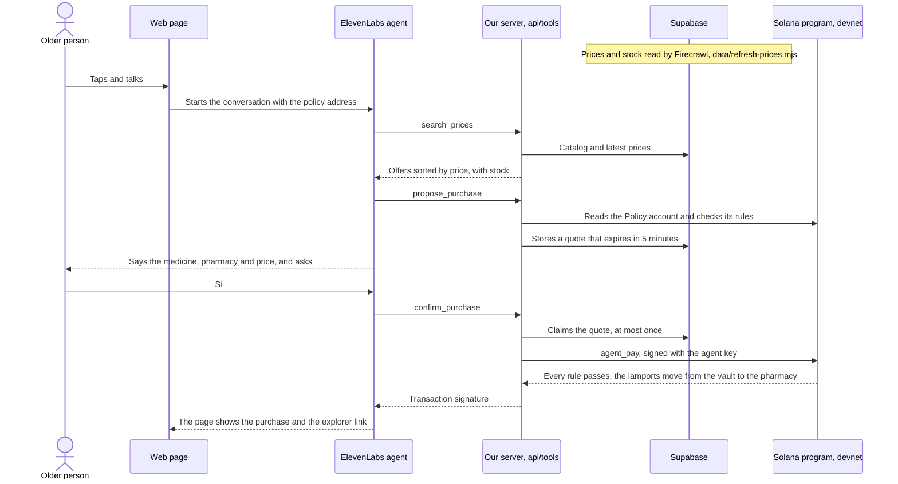
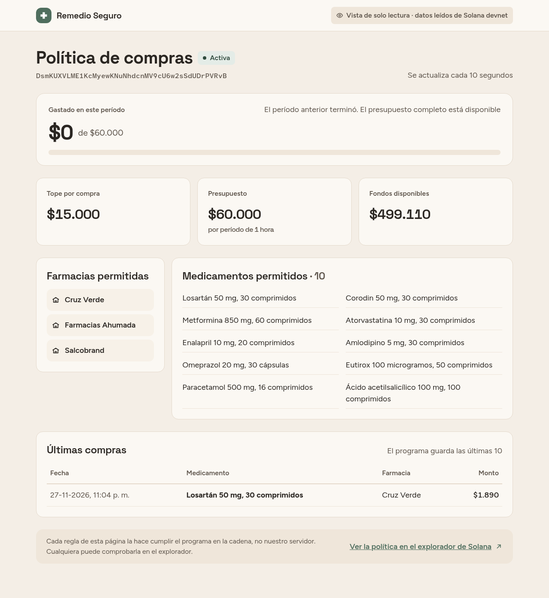

# Remedio Seguro

> Built for the Dev3pack Global Hackathon, 27 to 29 November 2026.
> **Status: in progress.** This README is filled in as each part works, and it never claims
> something that is not in the code.

**Live demo:** [dev3pack-hackathon.vercel.app](https://dev3pack-hackathon.vercel.app) · **Guest mode, no wallet:**
[`/invitado`](https://dev3pack-hackathon.vercel.app/invitado) · **A purchase made by voice:** [transaction on devnet](https://explorer.solana.com/tx/5h2hExaFKxz4ht5Uhdj3PLcJ2tXVuzhrAivSLESuXSrmcyfqipJsuw37oDCgb5ZSXQj9nb3pu2P8GCfuAaTdzWuA?cluster=devnet) ·
**Check it yourself:** [Verify it yourself](#verify-it-yourself)

## What it is

A voice agent that buys medicines for an older person, inside spending limits that their family
sets on Solana.

The family creates a policy: a budget per period, a cap per purchase, the pharmacies it allows and
the medicines it allows. The older person only talks. The agent compares prices in pharmacy chains,
proposes one, and pays after a spoken yes. A Solana program checks every rule before any payment:
if the AI is fooled or manipulated, it still cannot pay outside the policy.

Why it matters: the same medicine costs different amounts in each chain, and comparing them is hard
for an older person. In our price readings of 27 November 2026, losartán 50 mg (30 tablets) with
stock cost 1,890 pesos at Cruz Verde and 2,287 pesos at Salcobrand: 21% more for the same box.

## How it works

The family creates the policy on its own screen, `/familia`, with Phantom on devnet. A guest
policy is ready for the demo (listed below). Then one purchase goes like this:

1. The older person opens their page, `/p/<policy address>`, and talks. The voice is an ElevenLabs
   agent that speaks Spanish (Chile).
2. The person names a medicine. The agent calls `search_prices`. The server finds the medicine in
   the catalog, even when speech recognition spells it another way ("lozartán"). It returns the
   latest price and stock at each pharmacy, as Firecrawl read them, and how old each reading is.
3. The agent picks the cheapest pharmacy with stock and calls `propose_purchase`. The server reads
   the policy on devnet and checks the same rules as the program (paused, agent, pharmacy,
   medicine, cap per purchase, budget and vault balance), then stores a quote that expires in 5
   minutes.
4. The agent says the medicine, the pharmacy, the price and how old the price is, and asks. Only
   after a clear yes does it call `confirm_purchase`.
5. The server claims the quote (a missing, expired or already used quote is refused) and signs
   `agent_pay` with the agent's key. The program checks every rule again and moves the amount from
   the policy's vault to the pharmacy's devnet address. The agent says the purchase is paid, and
   the page links to the transaction.



The server holds the agent's key, never the family's money: whatever the agent is told, the
program refuses a payment outside the policy, and the server pays each quote at most once.

Example, made by voice on 28 November 2026: losartán 50 mg, 30 tablets, at Cruz Verde for 1,890
pesos.
[Transaction on devnet](https://explorer.solana.com/tx/5h2hExaFKxz4ht5Uhdj3PLcJ2tXVuzhrAivSLESuXSrmcyfqipJsuw37oDCgb5ZSXQj9nb3pu2P8GCfuAaTdzWuA?cluster=devnet):
1,890,000 lamports from the guest policy to the Cruz Verde address.

## Program addresses

| Network | Program | Address |
| --- | --- | --- |
| Devnet | `remedio_seguro` | [`Axg5mp8n16EGYXEmXVZD4XM3YT2jjsypH2Ep5tJKwaEF`](https://explorer.solana.com/address/Axg5mp8n16EGYXEmXVZD4XM3YT2jjsypH2Ep5tJKwaEF?cluster=devnet) |
| Devnet | Guest policy (guest mode) | [`DsmKUXVLME1KcMyewKNuNhdcnMV9cU6w2sSdUDrPVRvB`](https://explorer.solana.com/address/DsmKUXVLME1KcMyewKNuNhdcnMV9cU6w2sSdUDrPVRvB?cluster=devnet) |

## Try it

Live demo: [dev3pack-hackathon.vercel.app](https://dev3pack-hackathon.vercel.app), in Spanish (Chile). It deploys to Vercel from
`dev` (`vercel.json`). The guest mode needs no wallet and no real money:

1. Open [`/invitado`](https://dev3pack-hackathon.vercel.app/invitado), tap «Toca para hablar» and allow the microphone.
2. Say «Necesito losartán de 50». The agent compares three pharmacy chains and proposes the cheapest
   one with stock, with its price and how old the price reading is.
3. Say «Sí». The agent pays from the guest policy, and the page links to the transaction on devnet.
4. Open the guest policy's read-only view,
   [`/ver/DsmKUXVLME1KcMyewKNuNhdcnMV9cU6w2sSdUDrPVRvB`](https://dev3pack-hackathon.vercel.app/ver/DsmKUXVLME1KcMyewKNuNhdcnMV9cU6w2sSdUDrPVRvB): the limits, the
   amount spent and the last purchases, read from the chain.
5. To hear a refusal, ask for a medicine that is not on the list, such as «ibuprofeno».

The family screen, [`/familia`](https://dev3pack-hackathon.vercel.app/familia), needs the Phantom extension on devnet with test SOL.



## Run it locally

### The web app and the functions

Needs Node.js 22 or later.

```
npm install
npm run dev        # the web app, at http://localhost:5173
npm test           # tests of the functions in api/
npm run typecheck
npm run build      # the app, into app/dist
```

`npm run dev` serves only the app. To run the app and the functions in `api/` together, use the
Vercel CLI: `npx vercel dev`.

| Directory | What it holds |
| --- | --- |
| `app/` | The web app: Vite, React and TypeScript |
| `api/` | Vercel functions. Files and folders whose name starts with `_` are not published as functions |

The read-only view of a policy is at `/ver/<policy address>`. It reads the `Policy` account from
devnet with the IDL, and the names of medicines and pharmacies from Supabase
(`VITE_SUPABASE_URL`, `VITE_SUPABASE_ANON_KEY` in `.env`).

The older person's page is at `/p/<policy address>`. It starts the ElevenLabs conversation with
the dynamic variable `policy` set to that address (`VITE_ELEVENLABS_AGENT_ID` in `.env`). The
person can confirm by voice or with the Sí / No buttons, which send the same word to the agent.

The family screen is at `/familia`. It connects Phantom on devnet, creates a policy, pauses it and
closes it. The person's name is kept only in the browser (`localStorage`). The family screen shows
a list of the people you care for and the details of one at a time, with an estimated saving
computed from today's prices.

Guest mode is at `/invitado` and uses `VITE_GUEST_POLICY`.

### The voice agent's tools

The three tools are Vercel functions in `api/tools/`. The agent's prompt and tool definitions are
in `api/_agent/` (setup steps in [`api/_agent/README.md`](api/_agent/README.md)). To run the
same handlers from your machine, against Supabase and devnet, without Vercel or ElevenLabs:

```bash
npm run try:search                # reads the catalog and prices only
npm run try:purchase              # also proposes a purchase on the guest policy, pays nothing
npm run try:purchase -- --pay     # also confirms: one real payment on devnet
```

They need `SUPABASE_URL` and `SUPABASE_SERVICE_ROLE_KEY` in `.env`; `try:purchase` also needs
`AGENT_KEYPAIR` and `GUEST_POLICY`. On Vercel, the functions also need `AGENT_TOOL_SECRET`: a call
whose `x-agent-secret` header differs gets a 401.

### The program

Needs Rust, the Solana CLI 3.1.10 and the Anchor CLI 1.2.2 (`docs/team-setup.md`).

```bash
cd program
yarn install
yarn test:local
```

`yarn test:local` builds the program for SBPF v0 and runs the 19 tests on a local
`solana-test-validator`. CI runs the same command on every pull request
(`.github/workflows/ci.yml`, job `program`).

To check the deployed program on devnet, with the deploy wallet as the family:

```bash
cd program
ANCHOR_PROVIDER_URL=https://api.devnet.solana.com ANCHOR_WALLET=~/.config/solana/id.json \
  yarn run ts-node -P ./tsconfig.json scripts/smoke-devnet.ts
```

It creates a policy, pays 2,599 pesos, is refused over the cap (`OverPurchaseCap`) and while
paused (`Paused`), pays again after resuming, and closes the policy.

## What Solana does here

The spending limits are enforced by our own program, `remedio_seguro`, not by our server. Source:
[`program/programs/remedio_seguro/src/lib.rs`](program/programs/remedio_seguro/src/lib.rs). IDL:
[`idl/remedio_seguro.json`](idl/remedio_seguro.json).

- **The policy is the vault.** Each policy is one account (a PDA of the family's key and a seed)
  that stores the rules and also holds the money, in devnet SOL at 1 peso = 1,000 lamports. Our
  server never holds the family's money.
- **Only the program can move it.** The agent's key can sign a payment, but the payment is an
  instruction of the program, `agent_pay`, and it fails unless every rule passes. In this order:
  the policy is not paused; the signer is the policy's agent; the pharmacy is one of the allowed
  ones (at most 3); the medicine is one of the allowed ones (at most 10, stored as `sha256`
  hashes); the amount is above zero and within the cap per purchase; the amount fits in the budget
  of the current period (the period renews by itself); and the vault keeps its rent-exempt
  minimum. Each refusal has a name, such as `OverPurchaseCap`, that the voice agent reads out.
- **If the AI is fooled, it still cannot pay outside the policy.** A manipulated agent can only
  ask the program to pay; the program refuses anything the family did not allow.
- **The family keeps control.** Only the family's key can pause the policy (`set_paused`) or close
  it and take back every lamport (`close_policy`). Anyone can top it up with a normal SOL
  transfer.
- **The history is on-chain.** The policy keeps its last 10 purchases: amount, pharmacy, medicine,
  time and a hash of the quote the agent showed. The family can audit them without trusting our
  database.

Four instructions in all: `create_policy`, `agent_pay`, `set_paused`, `close_policy`. Each
refusal has its own test in [`program/tests/remedio_seguro.ts`](program/tests/remedio_seguro.ts).

## Verify it yourself

Each claim of this README can be checked without trusting us.

| Claim | How to check it |
| --- | --- |
| Our own program runs on devnet | The [program account](https://explorer.solana.com/address/Axg5mp8n16EGYXEmXVZD4XM3YT2jjsypH2Ep5tJKwaEF?cluster=devnet) is executable. Source: `program/programs/remedio_seguro/src/lib.rs` |
| The policy holds the money and the rules | The [guest policy account](https://explorer.solana.com/address/DsmKUXVLME1KcMyewKNuNhdcnMV9cU6w2sSdUDrPVRvB?cluster=devnet), or its [read-only view](https://dev3pack-hackathon.vercel.app/ver/DsmKUXVLME1KcMyewKNuNhdcnMV9cU6w2sSdUDrPVRvB), which decodes it with the IDL (`app/src/lib/policy.ts`) |
| The voice agent paid through the program | The [example transaction](https://explorer.solana.com/tx/5h2hExaFKxz4ht5Uhdj3PLcJ2tXVuzhrAivSLESuXSrmcyfqipJsuw37oDCgb5ZSXQj9nb3pu2P8GCfuAaTdzWuA?cluster=devnet): instruction `AgentPay`, 1,890,000 lamports from the policy to the pharmacy |
| Every rule has a test | `cd program && yarn test:local`: 19 tests, one per refusal. CI job `program` |
| The server and the web app are tested | `npm test`: 92 tests in `api/_tests/` and `app/src/`. CI job `app-and-api` |
| The agent's instructions | `api/_agent/prompt.md`, and the conversations used to try to break it in `api/_agent/prompt-tests.md` |
| No secrets in the repository | `scripts/check-secrets.sh`, CI job `hygiene` |

### Where each judging signal is

| Signal named by the organizers | Where to look |
| --- | --- |
| Eligibility | Our own Rust program on devnet ([Program addresses](#program-addresses)), a public repository and a video under 3 minutes (link in the submission form) |
| Product clarity | [What it is](#what-it-is) and [How it works](#how-it-works), with the diagram |
| Real-world impact | Older people in Chile who buy their medicines, and the price gap between chains ([What it is](#what-it-is)) |
| Demo quality | [Try it](#try-it): the guest mode completes the main flow from the live link |
| Deployment | The live app and its functions on Vercel (`vercel.json`) |
| Repository quality | 4 CI jobs (`.github/workflows/ci.yml`), 111 tests, the contracts between lanes (`docs/contracts.md`) and the rules for contributors (`AGENTS.md`, `CONTRIBUTING.md`) |
| Depth of Solana and SDK use | [What Solana does here](#what-solana-does-here): a PDA vault, four instructions and an on-chain purchase history. Anchor clients sign on the server (`api/_lib/solana.ts`) and in the browser with Phantom (`app/src/lib/familyTx.ts`) |

## Integrations

Filled in only when the integration runs. Each row names the file where it lives.

| Integration | What it does in the product | File |
| --- | --- | --- |
| Firecrawl | Reads the current price and stock of each catalog medicine on three pharmacy sites (Cruz Verde, Ahumada, Salcobrand) | `data/refresh-prices.mjs` |
| Supabase | Stores the catalog and the latest reading of each price. The browser key can read them and cannot write | `data/refresh-prices.mjs` |
| Supabase | The agent's server reads the catalog, prices and pharmacy addresses, and stores each quote. A quote is claimed in one conditional update, so it pays at most once | `api/_lib/catalog.ts`, `api/_lib/quotes.ts`, `api/_lib/pharmacies.ts` |
| ElevenLabs | The voice agent the older person talks to, in Spanish (Chile). It calls three webhook tools on our server, `search_prices`, `propose_purchase` and `confirm_purchase`, each with a shared secret header. The page starts the conversation with the policy as a dynamic variable | `api/_agent/`, `api/tools/`, `app/src/pages/OlderPerson.tsx` |
| Solana (agent side) | The server signs `agent_pay` with the agent's key, reads the policy before proposing, and turns each program error into a reason the voice can say | `api/_lib/solana.ts` |
| Solana (web side) | The read-only view decodes the `Policy` account from devnet with the IDL. The family screen signs `create_policy`, `set_paused` and `close_policy` with Phantom | `app/src/lib/policy.ts`, `app/src/lib/familyTx.ts`, `app/src/lib/phantom.ts` |

## What this project does not do

- **It does not buy a real medicine.** Payment is in devnet SOL, to devnet addresses we control.
- **It cannot prove a price is real.** Prices come from our own reading of pharmacy sites.
- **It does not keep the list of medicines private.** They are stored on-chain as hashes, which is
  obfuscation. The demo uses fictional people.
- **It does not validate prescriptions,** and the agent gives no medical advice.

## What was built during the hackathon

Everything in this repository. There is no earlier code.

## Team

Sebastián, Ruben, Victor and Luciano.

## License

MIT: see [`LICENSE`](LICENSE).

## Working on this repository

Rules for people and coding agents: [`AGENTS.md`](AGENTS.md). Guide to the documents:
[`docs/README.md`](docs/README.md).
