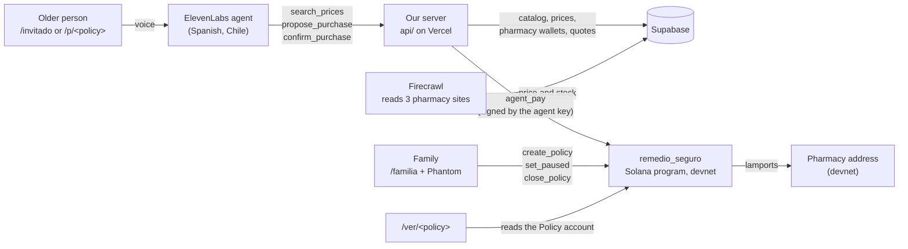

# Demo guide: how the live app works, for the pitch and the video

Written on 28 November 2026 (Chile) by the `program` lane (Ruben), for Sebastián and his agent.
Use it to prepare the 3-minute video and the pitch. It describes `dev` as of 28-11 after W6 (#39). The live site,
https://dev3pack-hackathon.vercel.app, is built from `main`: before recording, check that `main`
has caught up with `dev`, or W6 will not be on screen. Everything
here was checked in the code or on devnet. Nothing is claimed that is not running.

> For an agent reading this: explain it to Sebastián in Spanish, page by page, then help him
> write the video script with the outline in section 6. Do not invent features. If something
> here disagrees with the code, the code wins: say so.

## 1. The product in one breath

A voice agent buys medicines for an older person, inside limits that the family sets on Solana.

- **The family** puts the rules once: budget per period, cap per purchase, allowed pharmacies and
  medicines. It deposits the money into a vault that lives on-chain.
- **The older person** only talks. The agent compares prices in three Chilean chains and proposes
  the cheapest one with stock.
- **The Solana program** checks every rule before paying. If the AI is fooled or manipulated, it
  still cannot pay outside the policy. That is what a normal database cannot guarantee.

## 2. The pages, one by one

The app has five routes. The text the user sees is Spanish (Chile).

| Route | Who uses it | What it is for |
| --- | --- | --- |
| `/` | Everyone, the judge first | The entry: three doors into the product |
| `/invitado` | The judge | Talk to the agent and buy with a ready, funded test policy. No wallet, no funds, no sign-up |
| `/p/<policy>` | The older person | The same voice page, for a real family's policy. The family shares this link |
| `/ver/<policy>` | The family, the judge | A read-only view of a policy, read directly from the chain |
| `/familia` | The family | Connect Phantom on devnet, create a policy, pause it, close it |

### `/`: home

- **Look:** a bento grid in the «salvia y arena» look (sage, sand and terracotta), with the title
  «Habla. Nosotros cuidamos el resto.».
- **The three doors:**
  - **«Probar como invitado»**, the big sage tile, goes to `/invitado`;
  - **«Soy familia»** goes to `/familia`;
  - **«Ver la política de prueba»** goes to `/ver/<guest policy>`.
- **Below:** short facts about the test policy and the catalog: a cap of $15.000 per purchase,
  10 medicines, and every payment checked by a program on Solana.

### `/invitado` and `/p/<policy>`: the older person's page

Designed for someone of 85: **one idea per screen**, very large text, at most one number and one
or two huge buttons. No wallet, no crypto words. `/invitado` is this page with the guest policy
already set. The screens follow the conversation:

1. **«Toca para hablar»**: a big microphone. Tapping it starts the ElevenLabs voice agent. The
   page passes the policy address to the agent as a dynamic variable.
2. **«¿Qué remedio necesitas?»**: the agent is listening. The person says, for example, «necesito
   mi losartán de 50».
3. **«¿Compro tu losartán?»**: the proposal. It shows the pharmacy, the price and **«Ahorras $X»**,
   the difference against the next cheapest pharmacy **with stock**. The person confirms **by
   voice** («sí» or «no») **or** with the big **Sí** and **No** buttons. A button sends the same
   word to the agent.
4. **«Listo. Compraste tu losartán.»**: the purchase is paid on devnet. «Ahorraste $X», a button
   «Pedir otro remedio», and a quiet «Ver comprobante» link to the transaction in the Solana
   explorer.
5. **«No se puede comprar.»** with a reason. This screen appears when **the program's rules**
   refuse the purchase (paused, over the cap, over the budget, a medicine or pharmacy not allowed,
   no funds) or the quote expired. The voice explains why in plain Spanish.

### `/ver/<policy>`: read-only view

Everything on this page is read from the `Policy` account on devnet. Our server is not involved.

- **Header:** the status, «Activa» or «En pausa».
- **Limits and money:** what was spent in the period against the budget, the cap per purchase,
  the funds left in the vault and when the period renews.
- **What is allowed:** the allowed pharmacies and medicines. Medicines are stored on-chain as
  hashes; names come from the catalog.
- **History:** the last 10 purchases, kept on-chain.
- **Proof:** a link to the policy in the Solana explorer.
- **Savings (W6, #39):** an **estimated saving** card and an «Ahorro» column. The saving is
  estimated with today's prices, because savings are not stored anywhere.

### `/familia`: the family

- **Wallet:** connect Phantom, in testnet mode on Solana Devnet with test SOL.
- **Create:** a policy for a person in 4 steps: who it is for, spending limits, pharmacies and
  medicines. Both pickers are searchable lists with chips. The signature is the family's, in
  Phantom.
- **Manage:** pause, resume or close each policy. Closing returns every lamport to the family.
- **Names:** the person's name («Rosa · mamá») is kept **only in this browser**. On-chain there are
  only rules and amounts.
- **Layout (W6, #39):** a list of the people you care for on the left («Ahorro estimado entre
  todos» on top), and the chosen person on the right:
  - their name, «Copiar su enlace», pause and close;
  - 4 numbers: spent, estimated saving, funds and next renewal;
  - recent purchases and their rules.
  «Cuidar a otra persona» opens the creation form in the right panel.
- **For the video:** this screen needs Phantom, so the judge usually does not use it. Show it
  briefly as the family's side.

## 3. How the pieces talk to each other

**One purchase, step by step:**

1. The person talks. The agent calls `search_prices`, and the server answers with the price and
   stock in Cruz Verde, Ahumada and Salcobrand, as Firecrawl last read them.
2. The agent calls `propose_purchase`, choosing the cheapest pharmacy with stock. The server reads
   the policy on-chain, checks the same rules as the program, and stores a quote valid for 5
   minutes.
3. The person says or taps «sí». The agent calls `confirm_purchase`. The server claims the quote
   (it can pay only once) and signs `agent_pay` with the agent's key.
4. **The program checks every rule again** and moves the money from the policy's vault to the
   pharmacy's address. The page shows «Listo» and the explorer link.

**Who holds what:**
- **The family's key:** only the family. It creates, pauses and closes.
- **The agent's key:** the server. It can only call `agent_pay`.
- **The money:** in the policy account, which is a PDA. Only the program can move it, and only
  within the rules.

## 4. Facts to use on screen

| Item | Value |
| --- | --- |
| Live app | https://dev3pack-hackathon.vercel.app |
| Program (devnet) | `Axg5mp8n16EGYXEmXVZD4XM3YT2jjsypH2Ep5tJKwaEF` |
| Guest policy | `DsmKUXVLME1KcMyewKNuNhdcnMV9cU6w2sSdUDrPVRvB`: cap $15.000 per purchase, $60.000 per hour, 3 pharmacies, 10 medicines |
| A real voice purchase | Losartán 50 mg at Cruz Verde, $1.890, 28-11: [transaction](https://explorer.solana.com/tx/5h2hExaFKxz4ht5Uhdj3PLcJ2tXVuzhrAivSLESuXSrmcyfqipJsuw37oDCgb5ZSXQj9nb3pu2P8GCfuAaTdzWuA?cluster=devnet) |
| Payment unit | Devnet SOL, 1 peso = 1.000 lamports. No real money |
| Program rules, in order | Paused, agent, pharmacy, medicine, amount > 0, cap per purchase, budget per period, vault keeps its rent |
| Tests | 19 program tests in CI, one per rejection |

## 5. Before recording: the rejection shot

The checklist asks for **one visible rejection by the program**. With the guest policy that is not
easy by voice:
- **Cap:** its cap of $15.000 is above every catalog price.
- **Medicines:** it allows all 10.
- **Budget:** the hourly budget of $60.000 is hard to spend in a short clip.

Two clean ways to show it, both on devnet:

1. **Pause the guest policy for the clip.** The family key of the guest policy is the deploy
   wallet on Ruben's machine. Ruben pauses it, you ask for a medicine, the screen says «No se
   puede comprar. La familia pausó las compras por ahora.», and Ruben resumes it right after.
   Remember to resume.
2. **A second demo policy with a low cap**, for example $1.000. Asking for losartán ($1.890) is
   then refused with `OverPurchaseCap`: «La compra supera el tope por compra que puso la
   familia.». Ruben can create it with `program/scripts/guest-policy.ts` and a different seed, and
   share its `/p/<policy>` link.

Also check:
- **Funds:** the guest policy has funds (about 0.5 SOL) and its hourly budget has room.
- **Pharmacy accounts:** all three pharmacy addresses already hold rent. On 28-11 a purchase under
  $651 to a pharmacy with an empty account failed with `InsufficientFundsForRent`; it is fixed.
- **Fresh browser:** record from a private window, to show a judge's first experience.

## 6. A 3-minute video outline

The time budget is a suggestion. The video must be **under 3 minutes**, checked with the player.

| Time | What to show | What to say (idea) |
| --- | --- | --- |
| 0:00–0:20 | Title, then a person with a phone | Older people overpay for medicines, struggle with apps, and are a common target of scams. Their families want to help without handing over a card |
| 0:20–0:35 | `/` | Remedio Seguro: the family sets the rules on Solana, the older person only talks |
| 0:35–1:35 | `/invitado`, full purchase by voice | Ask for losartán. The agent compares 3 chains with live prices (Firecrawl), proposes the cheapest with stock and says the saving. Say «sí». «Listo», then open «Ver comprobante» in the explorer |
| 1:35–2:05 | The rejection (section 5) | Even if the AI is fooled, the program refuses: here the family paused, or the price is over the cap. The rule lives on-chain, not on our server |
| 2:05–2:30 | `/ver/<policy>`, then `/familia` for a few seconds | The family sees every purchase read from the chain, and can pause or close and get the money back |
| 2:30–2:55 | The diagram of section 3, or the code | Our own Anchor program on devnet: a vault, 4 instructions, 8 rules checked on every payment. ElevenLabs for voice, Firecrawl for prices, Supabase for the catalog and quotes |
| 2:55–3:00 | URL and team | Live at dev3pack-hackathon.vercel.app |

**Lines that work:**
- «La IA puede equivocarse; el programa no la deja pagar fuera de las reglas.»
- «La persona mayor no necesita billetera, ni contraseña, ni app: solo hablar.»
- «Cada compra queda en la cadena: la familia la puede auditar sin confiar en nosotros.»

## 7. What not to claim

Say these openly; the README says them too.

- **No real money:** it pays devnet SOL, to devnet addresses we control. No real medicine is
  bought.
- **Prices:** they come from our own reading of the pharmacy sites. The chain cannot prove a price
  is real. Each payment stores a hash of its quote, so it can be audited.
- **Savings:** they are an **estimate** against the next pharmacy with stock, not a guarantee.
- **Privacy:** medicines are stored on-chain as hashes. That is obfuscation, not privacy, and the
  demo uses fictional people.
- **Prescriptions:** the app does not validate them, and the agent gives no medical advice.
- **Solana Mobile:** we are not in that track. There is no Android app.
